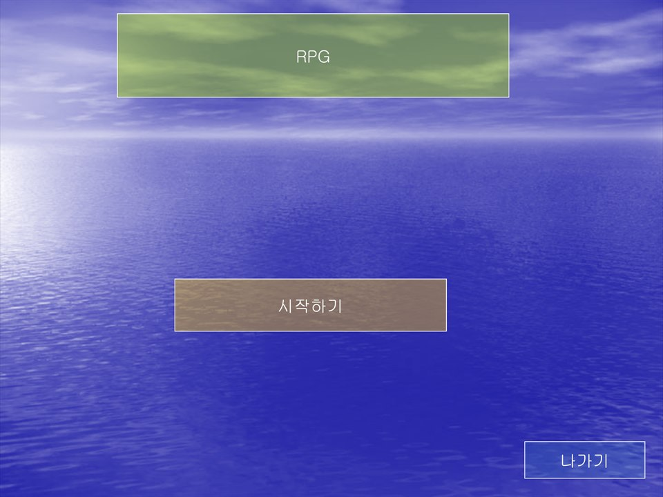
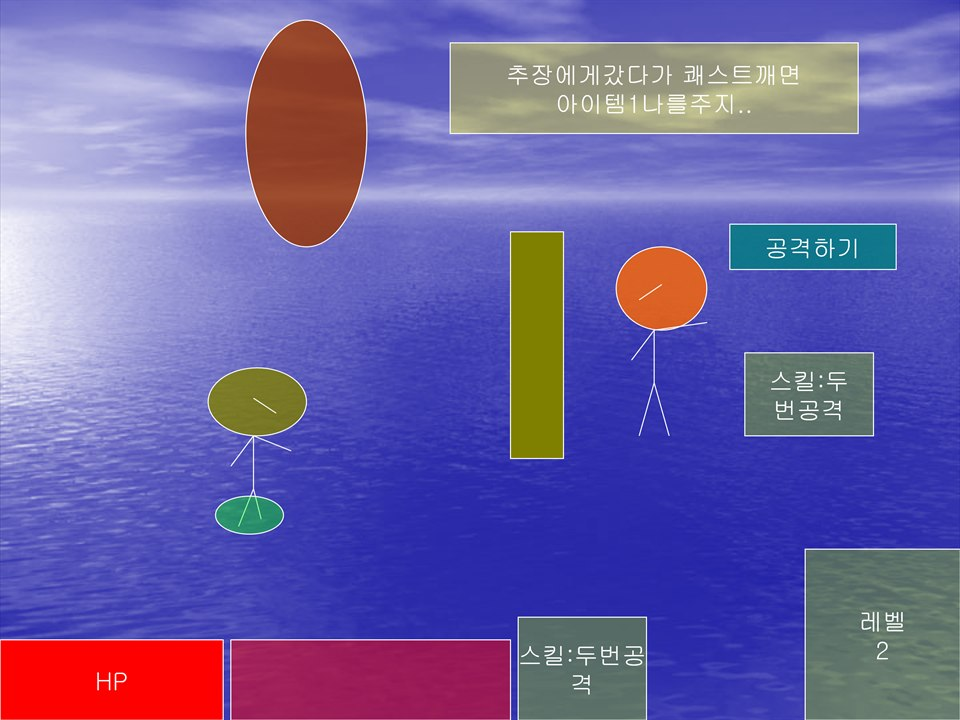

# PowerPoint RPG

[한국어](README.ko.md)

An RPG made in PowerPoint. It uses hyperlinks and slide transitions to build in a health bar, levelling up, skills and even NPCs that hand out quests.

  
  

## How to play

Download it from Releases and run it, and it opens straight into the slideshow. PowerPoint or PowerPoint Viewer must be installed. You can also open `source/powerpoint-rpg.ppt` and press F5.

Everything is controlled with the mouse. Click a button or shape on screen to move on.

## Files

| Path | Contents |
|---|---|
| `source/powerpoint-rpg.ppt` | Original project file |
| `docs/screenshots/` | Screenshots |
| Releases | Distribution files |

## License

CC BY-NC-ND 4.0. Unmodified copies may be shared for noncommercial purposes with attribution. Distributing modified versions and commercial use are not allowed. Bundled libraries, graphics, sounds, and maps made by other people keep their own rights. See [LICENSE](LICENSE).
